# 设计说明

[English](design.en.md) · [返回 README](../README.md)

这里收录每个 skill 的设计原则、实现取舍、算法细节与架构说明，以及仓库的门禁、自检与编辑约定。安装方式、触发词和调用示例都留在 [README](../README.md)。

同一套架构移植多次的分组，共有部分只画一次流程图，各成员的图只画它自己多出来的那一段。

章节：[工具](#工具) · [项目规范](#项目规范) · [语言角](#语言角) · [Scoop bucket](#scoop-bucket) · [维护一个 skill](#维护一个-skill)

## 工具

### skill-draft

把一段工作流或一块领域知识变成 Skill 包，并让其中每个文件在**落盘之前**就通过质量门禁。

铁律是「门禁不过，文件就不算完成」，且每次写入后立刻重跑门禁。一条命令驱动全部：

```bash
python <this skill dir>/scripts/verify.py <file-or-dir>...
```

每种文件类型都走三段式流水线——内置检查、修复、复核——复核阶段必须退出码为零。当前覆盖范围：

| 类型                       | 工具                          |
| :------------------------- | :---------------------------- |
| `.py`                      | ruff + ty，外加进程内语法编译 |
| `.md`                      | rumdl                         |
| `.json` / `.jsonc`         | 解析校验                      |
| `.ts` / `.js` 系           | oxlint + oxfmt                |
| `.css` / `.scss` / `.less` | oxfmt                         |
| `.png`                     | oxipng + chunk/CRC 完整性复检 |

新增文件类型通常只需改 `scripts/file-types.json`，无需改代码；进程内检查写进 `scripts/checkers.py`。整个包只用 Python 标准库，因此任何机器上都能跑。

包级另有一道独立的 `package` 规则：`no-local-paths` 与 `package-selfcheck`。后者动态发现包内 `scripts/` 下的自检入口，用当前解释器起子进程，把包内往返自检接进门禁——门禁跑 ruff / ty / rumdl，包内自检跑配方、题库、文档与代码的一致性，两者过去互不覆盖。它只在门禁指向整包或整个仓库时触发，单文件门禁不触发。`python <this skill dir>/scripts/verify.py --list` 只读列规则表；**完整门禁的修复阶段会写盘**，复核前别把它的输出当成只读结论。

`SKILL.md` 里还有一节很长的 `Gotchas`，记录了那些花了真实调试时间的坑——为什么 `oxlint` 需要 `--deny-warnings`、为什么 `oxipng` 的退出码不可信、为什么 `.jsonc` 这个后缀有时是刻意为之而非拼错。

流程如下，回跳门禁的那一环画在它真正发生的位置：

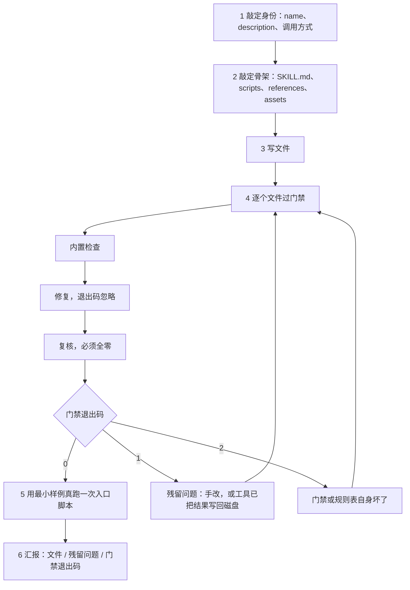

### media-merge

用 ffmpeg 把多段视频或音频拼成一段或几组，并把「该不该重编、重编哪几段」变成可判定的。

第一轮只探测、只出表，不碰文件。「合不合、怎么分组」留给用户——素材动辄几十段、几 GB，替他默认全并一次，跑完才发现分错了，代价是一小时。表里只放判定真正用到的列（视频：编码、分辨率、帧率、帧数、时长、音轨；音频：编码、采样率、声道、码率、时长），序号是后面指定分组的唯一依据。

探测先分类型：全是视频走视频线，全是音频走音频线，混排直接报错。两条线的判定维度不同：

| 类型 | 判定维度                                      | `copy`   | `encode-minor` | `normalize`      |
| :--- | --------------------------------------------- | -------- | -------------- | ---------------- |
| 视频 | 分辨率、帧率、像素格式、SAR、色彩、编码、音轨 | 全部一致 | 仅视频编码不同 | 几何或音轨不同   |
| 音频 | 编码、采样率、声道                            | 三项全同 | 仅编码不同     | 采样率或声道不同 |

判定的关键是把「几何」与「编码」分开看：几何决定要不要缩放补边，编码决定要不要重编。混在一起判，会把「只有编码不同」误判成全量归一化，白白重编主段。但**音轨不遵循这条**——`-c copy` 要求同一条轨道里编码相同，只差音轨时让视频段直接 copy 会产出混编码音轨，所以音轨差异一律升级到 `normalize`。

一条命令出表，`-f md` 让表格可以直接贴进对话；`--groups` 按序号区间分组，每组各自判定、各自成片：

```bash
python <this skill dir>/scripts/mmerge.py -f md a.mp4 b.mp4                    # 出表 + 整段方案
python <this skill dir>/scripts/mmerge.py --groups 1-11,12-25,26-34 a.mp4 ...  # 分组预览
python <this skill dir>/scripts/mmerge.py --groups 1-11,12-25,26-34 --run a.mp4 ...
python <this skill dir>/scripts/mmerge.py --audio-only --run a.mp4 b.mp4
```

分组默认**每组各算各的**：组内全是 1080p 就按 1080p 出，另一组全是 720p 就按 720p 出，各组画质损失最小。代价是组间参数可能不同，成片不能再直接拼起来；`--uniform` 让各组共用一套目标参数换取可拼接，而 `1080p` 组被拉到 `720p` 是真掉信息，反过来只是变大。这层取舍要讲给用户，不该由脚本替他默认。

音频的目标编码按源决定，不按「文件更大就更好」：全部无损就保持 `flac`，主编码是 mp3 就回到 mp3，其余统一 `aac`；采样率与声道取各源的最大值（升采样不丢信息，降采样会丢），码率跟住有损源并夹在 128–320 kbps。把无损源压成有损是最容易犯的错，脚本不提供这个选项。

长片一律分两阶段——逐段归一化到 `segs/`，再拼接。单条 `concat` 滤镜是「一个 N 输入的大流水线」，中断即全废；分段落盘可以随时续，这也是 34 段、2 小时 21 分那批素材唯一跑得完的方式。唯一的例外是 flac：raw `.flac` 不接受 `-c copy` 拼接（块长会写错，成品只认第一段），最后一步换成 concat 滤镜重编，而 flac 对 flac 是无损的。

`references/params.md` 记录实测的 preset/CRF 速度与码率表、画布与补边的取舍、音频码率的推算规则，以及哪些封装能 `-c copy` 拼接。`references/casebook.md` 是六次真实拼接与踩坑清单，包括 Windows 下 ffprobe 输出 CRLF 让判定静默失败、浮点帧率进整数比较、`-c copy` 把首段 `avcC` 套到全片、内嵌封面被当成视频流，以及 flac 拼接只出一半——这些问题只在真机上才会暴露。

流程如下，用户那一环画在它真正发生的位置：

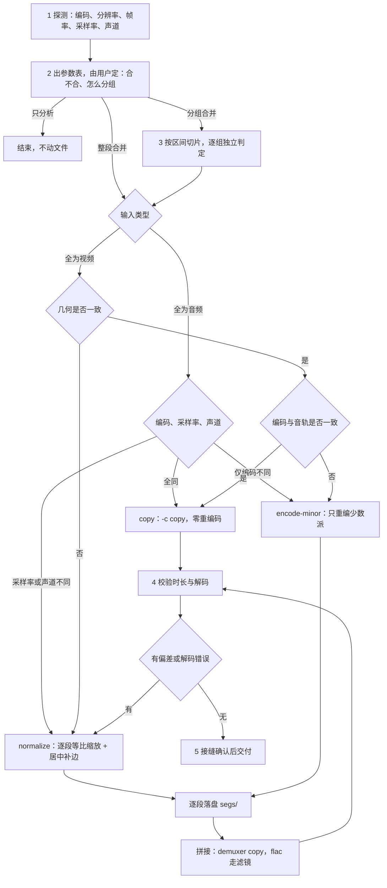

### svg2drawio

把 SVG 转成 draw.io，分两条工序；先判该走哪条，再谈保真与可编辑。

`--probe` 一次给出页尺寸、文字元素数、字形引用数、字形定义数、字体子集数、path 分类和多子路径描边数。判据只有一条：**文字是不是真 `<text>`**。是，走图形内嵌——按单元裁成 SVG 图像单元，文字剥离成可编辑 cell，两者包成一个组；不是，走全可编辑重建——先把字形反推成字符表，再按语义重建框、连线、标签。

为什么不能一条路通吃：draw.io 的 `mxGraphModel` 没有贝塞尔图元，图形只能内嵌或近似；而 cairo/Pango 从 PDF 导出的图**一个 `<text>` 都没有**，13994 个 `<use>` 各自引用字体子集里的字形。按内嵌处理，转完看着成功，一个字都留不下——批量跑完才发现，代价是整批重来。所以第二条工序的第一步不是转换，是反推字形。

反推这一步要栅格化与距离变换，只能用 numpy / Pillow / scipy，**刻意不进包内脚本**（包内一律标准库，否则换机器就跑不起来）。算法与参数写进 `references/outline-pipeline.md`：64×64 单元、**居中放置**（不居中会把 `r` 判成 `P`，且错得很有规律）、IoU 粗筛 40 个候选再算 chamfer、用相邻 `<use>` 的 `x` 差反推 advance、衬线/西里尔/希腊三套字库、以及西里尔同形字按词判语言再归一。

```bash
python <this skill dir>/scripts/rebuild.py page.svg --probe          # 判工序
python <this skill dir>/scripts/svg2drawio.py a.svg -o out/          # 内嵌
python <this skill dir>/scripts/rebuild.py page.svg --glyphs g.tsv   # 重建
python <this skill dir>/scripts/selfcheck.py                         # 14 项自检
```

重建的判定阈值全是实测校准的：填充路径小于 12×12 是箭头、`fill-opacity < 0.3` 是阴影、四个 `C` 加一个 `Z` 是卡片边框、其余描边是连线；圆角按顶边直线段的起点量，不是「路径起点到左边界的距离」。

踩过的坑里最贵的三个：一个 `d` 里常有多条不相连的线（不按子路径拆，就是满页斜线）；画到框边又折返的「总线」按「一条描边 = 一条连线」合并会走两遍，实线看不出来、虚线相位交错后糊成实线；边少了 `edge="1"` 属性，draw.io 一条线都不画，而 XML 完全合法。

`references/drawio-quirks.md` 是十三条硬约束（含 `dashPattern` 以线宽为单位、单点 `<Array>` 会被丢弃、文档顺序即图层顺序）；`references/verification.md` 给出大图的 1:1 对齐、IoU 与残差连通域判定——2526×4167、1210 条连线的成图，最佳 IoU 0.74，距离变换 > 4px 的残差只剩 5×50 的细条。

流程如下：

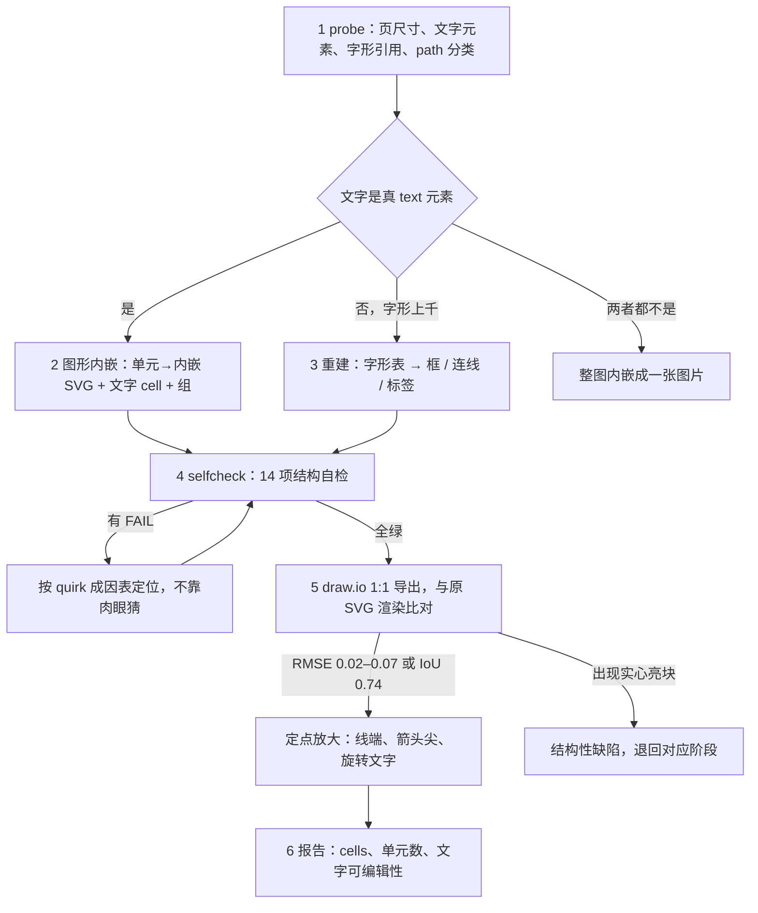

### typ2drawio

把一批 `vNN-*.typ` 讲义按固定版式批量生成为可编辑的 `mxGraphModel` .drawio：中心只写章名，四个扇区照 `references/layout.md` 的几何与配色排布，先修知识点只从教案 docx 取。有 docx 目录时产物编号取 docx 文件名，否则取讲义的 `NN`。

```bash
python <this skill dir>/scripts/typ2drawio.py --typ-dir LECTURES --docx-dir LESSONS --out-dir OUT --preview OUT/preview.html
python <this skill dir>/scripts/verify_drawio.py --out-dir OUT --docx-dir LESSONS
python <this skill dir>/scripts/selfcheck.py
```

生成与校验分开：校验只读，挡住公式与示例标识符噪声、节点矩形重叠、连线穿节点、标签压节点、包含关系箭头反向和编号不对齐；`selfcheck.py` 再核包内一致性、样例往返与外部规则表。

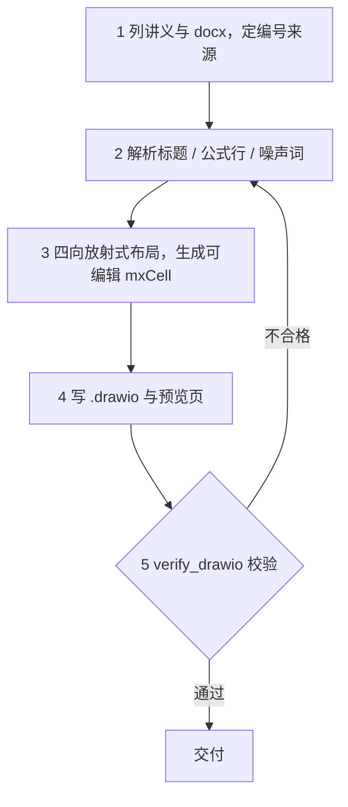

### drawio2vsdx

把 draw.io 的 `mxCell` 图保真转成 Visio .vsdx：纯 Python 直接生成 OPC 包，不需要装 Visio；`<br>` 归一化为真换行，页面尺寸按 96 PPI 换算。形状几何、颜色写法与端点约定集中在外部规则表里，改动先过反向测试。

```bash
python <this skill dir>/scripts/drawio2vsdx.py --in-dir OUT --out-dir VSDX
python <this skill dir>/scripts/verify_vsdx.py --drawio-dir OUT --vsdx-dir VSDX
python <this skill dir>/scripts/selfcheck.py
```

静态校验与反向渲染抽查成对出现：前者挡住 document 底边被压平、形状集合与规则表不符，后者把 VSDX 读回来再渲染一次；`selfcheck.py` 还会用负样本确认校验器真的会报错。

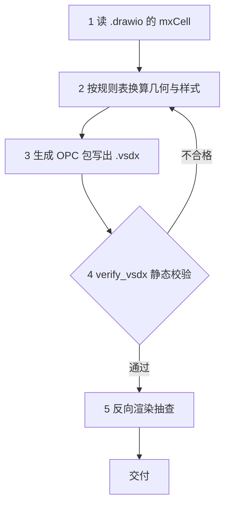

## 项目规范

这三个 skill 为另一个独立仓库（lectures）编码内部约定。前两个只描述约定：动手前先问，但从不检查你写下的文件。`project-tex` 是其中的例外——它自带检查脚本，因此也有机械执行的一半。

### project-py

写 `.py` 源码的规则。Notebook 明确不在范围内。

- **包管理器是硬门禁。** 禁止 `pip install`——即使本机所有环境里都没有这个包。依赖只能通过 `micromamba` 或 `uv` 变更，且先与用户确认选哪个——用 `micromamba` 时，还要在动手前问清具体的环境名。两条路都不通就停下并汇报探测结果与缺什么，**`pip` 不是兜底**。
- **运行同样设门禁。** 只要脚本的 import 越出标准库，就不会直接跑——先探测本机的 `micromamba` / `mamba` 环境，再由你在交互提示里选定；该提示永远带一个「暂停，我自己装」的出口，选中即结束任务，而不是悄悄装点什么——选它意味着把装包交回给你，而不是解禁 `pip`。
- **风格。** 用 `enumerate()` / `zip()` 迭代，绝不用 `range(len())`；Matplotlib 走面向对象接口并设 `constrained_layout=True`；装饰批量通过 `ax.set(...)`，spines 作为单个列表传入。
- **静态检查顺序固定：format → check → ty。** 格式化不是可选项，因为 `ruff check` 过了并不代表格式没问题。`ty` 必须指向一个确实装了依赖的解释器，否则会刷出一大片假的 `unresolved-import` 告警。
- **死代码扫出来的是线索，不是结论。** `scripts/deadcode_scan.py` 按引用计数找没人用的顶层定义，但**带装饰器的函数一律按活代码处理**——`@app.get("/path")` 靠路径字符串注册，函数名不会第二次出现，这是引用计数唯一的真盲区。删完立刻跑 lint：死函数常是某条 import 的唯一消费者，交给 F401 去找。
- **任何地方都不写绝对路径、不写固定版本号**——文档、脚本、配置（含 `ty.toml`）一视同仁。两者都在运行时解析，因为硬编码的路径在机器一变的那一刻就变成错误信息。

`references/toolchain.md` 存放命令速查与隔离注意事项，`references/deadcode.md` 存放死代码清理流程与它的盲区。

三条路进入同一个 skill：变更依赖、普通改动，以及要运行的脚本：

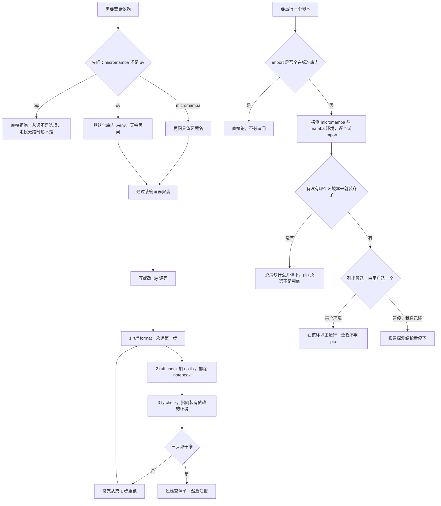

### project-tex

LaTeX 数学公式的内部风格。每条规则都是「不写 X，改写 Y」的形式，所以这个 skill 存在的意义就是拦住那几个反复回潮的坏习惯：

- **按语义挑环境。** 多行公式、矩阵、分段函数要用能说明自己是什么的环境——`gathered`、`gather`、`aligned`、`cases`、`vmatrix`、`bmatrix`——绝不用没有语义的 `array`。如果说不出某条公式为什么用它那个环境，那就是选错了。
- **括号尺寸显式写出。** `\left…\right` 换成固定档的 `\big` / `\Big` / `\bigg` / `\Bigg`，按内容挑一档，这样括号在反复编辑之间保持稳定，而不是默默改变大小。
- **一种记号一种写法。** 转置用 `^{\top}`，极限用 `\to`，用 `\underset{}{}` 而非 `\limits_`，用 `\mathrm` / `\mathbf` / `\mathit` 取代旧的 `{\rm }` / `{\bf }` / `{\it }`。每个 `\underset` 都写全两个参数位，不用的一侧留空花括号。
- **写完跑检查。** `scripts/check_style.py` 是规则表的机械孪生，共用同一套九个 id，只报告不改写；退出码 0 即为完成标准。

`references/examples.md` 存放每种环境可整块照抄的样例，这也是单靠规则表最难推断的部分。

四步，检查脚本就是完成标准：

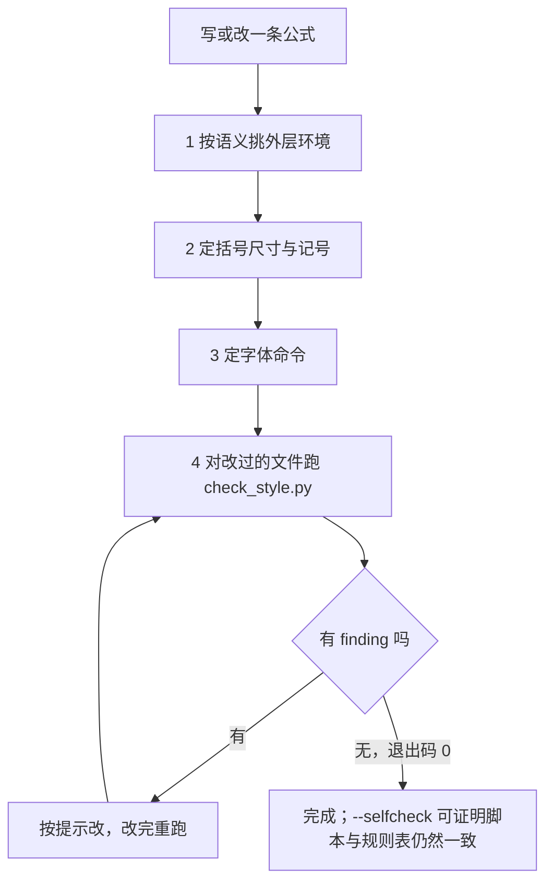

这个检查脚本本身值得单说一句：它既读 Markdown 也读 `.tex`，从 `$…$`、`$$…$$`、`\(…\)`、`\[…\]` 以及 `latex` 代码块里抽取公式，其余部分以不破坏字符偏移的方式置空，因此报出的位置仍能对上正确的行列。`--selfcheck`（旧名 `--list-rules`）兼作一致性审计：如果某个 id 只存在于脚本中而没写进 `SKILL.md`，它会失败。

### project-typ

编写与修改 Typst 课件的规则。

- **写辅助函数之前先查包。** 在定义任何自定义函数之前，先去 `qooklet`、`touying-quick` 和 `theorion` 里找现成实现——多数版式需求（表格、代码块、提示框、公式编号、图表引用）都已被解决，重造一遍只会带来不一致的排版。
- **所有外部内容都落在文件里，绝不内联。** 代码放到 `python/`、`blender/` 或 `cv40examples/`，再通过 `read()` 引入；图片放到 `images/`，并用 `figure(image(...), caption: none)` 包起来；数据放到 `data/`，尽量用 CSV，供 `tableq(data, k)` 使用。路径一律相对于仓库根目录。
- **版式。** 定高两栏用 `columns()` 并在两栏之间显式写 `#colbreak()`，每栏各自包在 `#[ … ]` 里——漏掉 `#colbreak()` 会静默改变版式，因为 `columns()` 是流式的而非定位式的。
- **散文不许切碎。** 中文长句保持完整，断句用逗号和分号，不用句号。
- **不要展示 PDF。** 编译只用于验证。报告结论——是否构建成功、哪一行失败、`slide_qa.py` 标记了哪几页——而不是把 PDF 推到用户编辑器里。

`references/packages.md` 记录三个包导出的符号；`references/syntax.md` 收集高频 Typst 写法与坑。

课件是最后才碰的东西，一切外部内容先落成文件：

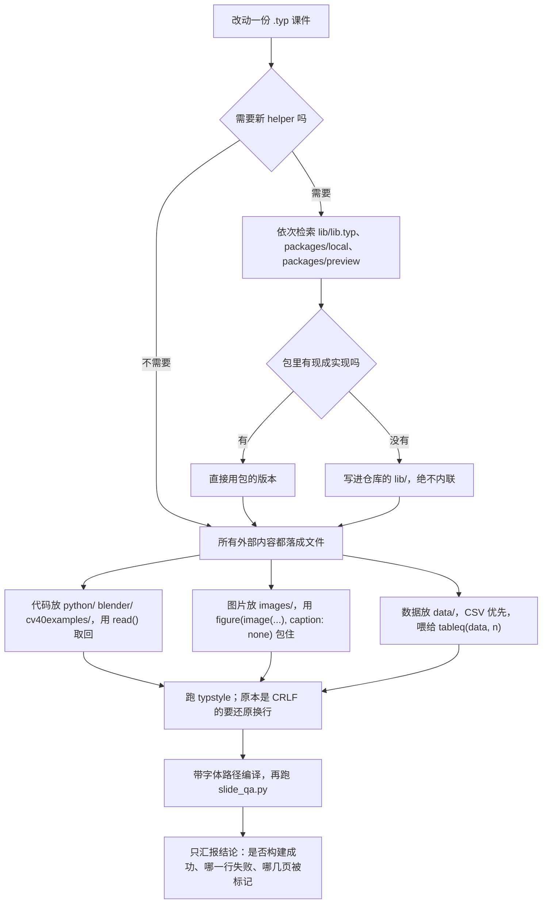

## 语言角

两个姊妹 skill，为每周一次的语言角生成主持资料：一页沉浸式外文主持脚本，三十个讨论问题穿插在主持词里而不单列成块，每题下方另起一行给三到五个提示词，外加按词性分组的生词表。两者面向同一套固定规格——十人以内、九十分钟的平等圆桌，不含辅导、不分小组、不布置作业。

它们是同一个包移植到两种语言，因此共用文件布局（`scripts/corner_config.py`、`corner_skill.py`、`corner_audit.py`）、同一组三条命令，以及同样的 intake 形态。不同的只是语言本身、各自标注的考试等级体系，以及话题库。

|          | `anchor-french`                | `anchor-spanish`               |
| :------- | :----------------------------- | :----------------------------- |
| 语言     | 仅法语                         | 仅西班牙语                     |
| 考试等级 | DELF / DALF                    | DELE                           |
| 水平区间 | B1–C2，含混合                  | B1–C2，含混合                  |
| 产出     | `docs/fr-<topic>.md`           | `docs/es-<topic>.md`           |
| 配置     | `assets/fr-corner-config.json` | `assets/es-corner-config.json` |

**配置文件是唯一数据源。** 语法点、水平、规模、话题库与话题维度、时间分配、词汇量目标、每题提示词条数、考试等级体系、输出路径模板，全都存放在该包唯一的那份 JSON 资产里；`SKILL.md` 只描述流程、风格与方法论，自身不携带任何选项数据。增删选项意味着只改 JSON，不动其他任何文件。

**每个包只服务一种语言，这是刻意的。** 两者都不在运行时按语言分派。两个构建之间唯一允许的差异是 `corner_config.py` 顶部那三个身份常量——包名、语言键、配置文件名——而审计会在某个包引用了另一个包的配置时报错。

**三条命令，全部离线、全部只用标准库。** 在包根目录执行：

| 命令                              | 职责                                       |
| :-------------------------------- | :----------------------------------------- |
| `python scripts/corner_config.py` | 加载并校验 JSON，然后打印解析结果          |
| `python scripts/corner_skill.py`  | 驱动 intake 状态机并导出简报               |
| `python scripts/corner_audit.py`  | 审计 schema、身份、文档 ↔ 配置、跨语言纯度 |

`corner_skill.py selftest` 检查推荐配对，而不是启动一次 intake。

**intake 先问后写。** 提问编排——顺序、类型、依赖、每题上限，以及超过六个选项时如何拆成子问题——来自配置而非模型自行判断。所有选项都可点击勾选，二级语法题只有在一级已回答后才展开，而你若在消息里已经给出某个参数，对应那一问会被跳过而不是再问一遍。

### anchor-french

法语角的主持资料包，按 DELF / DALF（B1–C2）标注。提问编排走五问——一级语法点（最多两个）、据其衍生的二级语法点、参与者水平、话题、规模——其中话题那一问提供三条路径：从题库挑选、随机取一个，或自行输入。

intake 是一台由配置驱动的状态机，而不是靠模型自行判断：

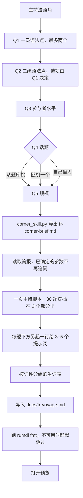

### anchor-spanish

西班牙语角的主持资料包，同一条流水线，但按 DELE 标注。它的话题库是自有的，而不是法语库的翻译版；语法点树、词性分组名与词汇量目标也各自独立，而 intake 跑的仍是同一套五问题编排。

同一台状态机，按 DELE 标注：

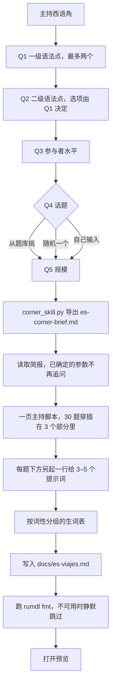

## Scoop bucket

三个姊妹 skill，把「上游发了新包」或「上游发了新版本」变成一条命令。它们共用一套架构：配方目录、共享库、三命令 CLI、自检，以及一个在写入前校验结果的规则引擎。

它们只在各自目标仓库的强制要求下才产生差异。两个 extras 构建是同一个 skill 移植到两个 bucket，README 约定不同、主要包形态也不同；`scoop-extras-cn` 还额外地在自己 `references/lint-rules.md` 的 divergence 节与 `references/coverage.md` 开头记录了它与 `scoop-extras-plus` 的分歧。

|             | `scoop-main-plus`          | `scoop-extras-plus`          | `scoop-extras-cn`          |
| :---------- | :------------------------- | :--------------------------- | :------------------------- |
| 目标 bucket | `$Scoop/buckets/main-plus` | `$Scoop/buckets/extras-plus` | `$Scoop/buckets/extras-cn` |
| 配方数      | 18                         | 16                           | 16                         |
| 规则数      | 23                         | 23                           | 23                         |
| README 语言 | 英文                       | 英文                         | 中文                       |

**共同形态。** 三者都对外暴露同样三条触发命令：

| 命令       | 别名    | 职责                               |
| :--------- | :------ | :--------------------------------- |
| `generate` | `gen`   | 按配方构建 manifest 并填好字段     |
| `update`   | `upd`   | 改字段、升版本、重算哈希、探测上游 |
| `lint`     | `check` | 跑规则目录并修复格式               |

除 `--checkver`、`--fetch-hash` 与 `--rehash` 外全部离线。只用 Python 标准库，且仓库的 Python 目标版本为 3.14；脚本未使用任何受版本限制的语法，因此更早的 3.x 也能解析。脚本自行推导包根目录，可从任意工作目录执行。

三条命令背后是同一条管线：

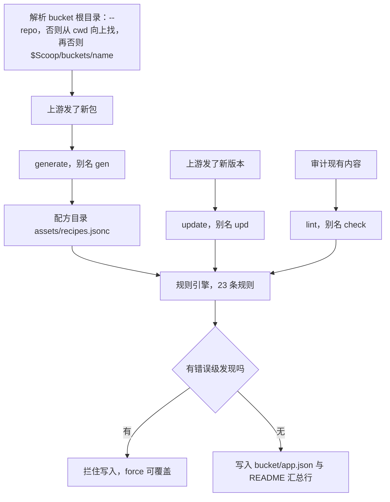

### 共同保证

- **bucket 根目录在运行时解析**，绝不写死。展开顺序为 `--repo <path>`、再向上遍历当前目录、最后落到 `$Scoop` 下该 bucket 自身的安装副本。任何包里的任何文件都不存展开后的 Scoop 路径，一旦出现字面量自检就会失败。
- **规则引擎先于写入运行。** 错误级发现会拦住写入，`--force` 可覆盖。`--dry-run` 预览，`--print-json` 输出结果。
- **已有键序保持不变。** `update` 只把*新增*字段插到其规范位置；要整体重排需显式 `--reorder`。
- **哈希从不凭空捏造。** 要么 `--fetch-hash` 流式下载并计算，要么 `--hash-from-file` 用磁盘上已有的包，要么运行结束打印提示，让你后续用 `bin/checkhashes.ps1` 处理。
- **README 是受控的。** 同步只碰它认得的那几张汇总表，其余列保持逐字节不变。缺少小节时会跳过同步并给出说明，而不是把文件改坏。
- **行尾全局为 CRLF。** `.editorconfig` 对 `[*]` 设了 `end_of_line = crlf`，`.gitattributes` 让工作区与之保持一致。完整的 `lint` 会遍历目录树，报出每一个不是 CRLF 的文本文件（`W112`）；这一遍是只读的，`--fix-format` 只重写 skill 自己拥有的两样东西：`bucket/*.json` 与 `README.md`。
- **不支持 32bit。** `arch` 只接受 `64bit` 与 `arm64`，因此 `url32` / `hash32` 既不接受也不产出。

写入目标永远是 `<repo>/bucket/<app>.json` 加上 README 那一行；`bin/`、`scripts/` 与 `.github/` 属于 Scoop 及各仓库 CI，绝不写入——`W112` 那一遍会读取并报告它们，但不动它们。

### scoop-main-plus

**Main-Plus** bucket 的 manifest，以 bin 为主：40 个包里 39 个通过 `bin` 安装，且完全没有声明 `shortcuts`。出现快捷方式是例外，说明该包并非真正的 CLI 工具。未给 `--repo` 时，该 bucket 从任意工作目录都能解析到 `$Scoop/buckets/main-plus`。

`generate` 会先敲定六个问题——上游、交付内容、版本、什么进 PATH、是否真要快捷方式、README 用什么语言实现——并且是问而不是猜。这个 bucket 输出规范键序，用 `--flat-url` 折叠单架构的 `architecture` 块，并在 `references/coverage.md` 里为它的 18 个配方逐一记录入选依据。

`generate` 先问再建，哈希有三个正当来源：

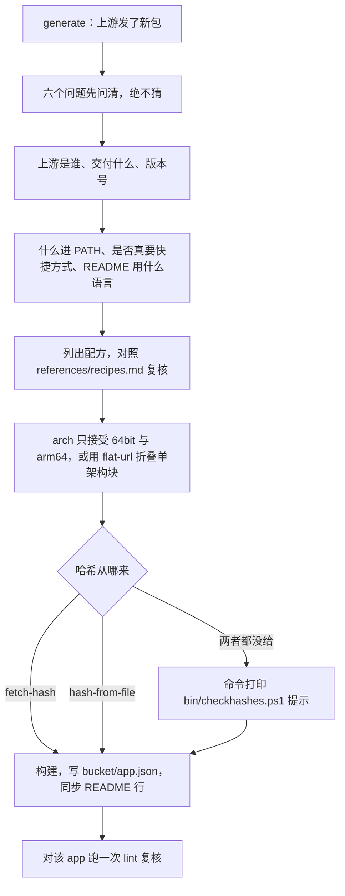

### scoop-extras-plus

**Extras-Plus** bucket 的 manifest（56 个 manifest，面向英文）。十六个配方；README 有一张 `## ⭐️ Summary` 表横跨五个 `###` 小节，三列为 `App / Auto-Update ? / Note`。

`lint` 的目标基线是**整个 bucket 零错误级发现**，包内自检却不把它当硬断言：外部 bucket 随时会因上游提交新增错误级发现，自检照常打印明细、只记警告，失败留给包自身能修的问题。`lint` 打印实时计数而非冻结数字，因为该 bucket 会随每次 autoupdate 提交而增长。`SKILL.md` 列出了迄今发现的真实问题，每条都标出是哪个规则抓到的——URL 里钉的版本已与 `version` 不符、Scoop 不接受的 `md5:` 哈希前缀，以及若干处与 manifest 名漂移了的 README 拼写。

关于这个 bucket 的多数问题，`lint` 一个命令就能答：

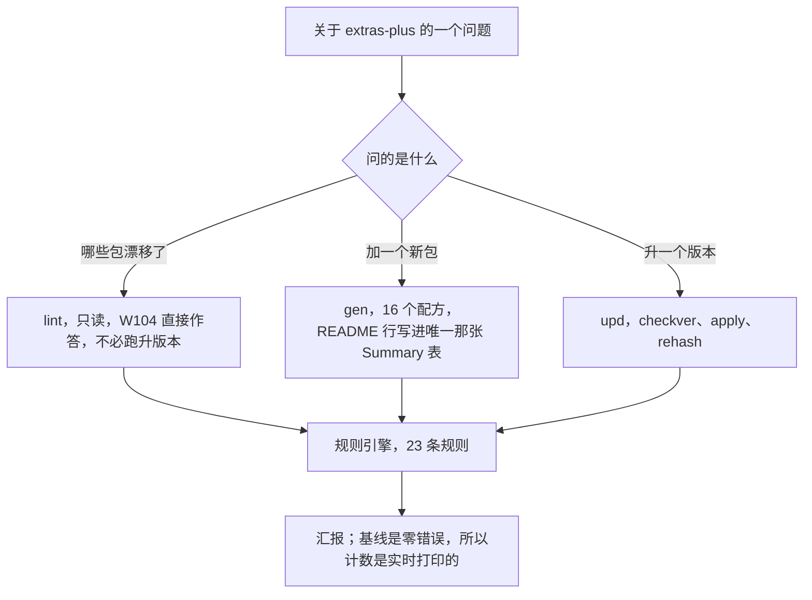

### scoop-extras-cn

**Extras-CN** bucket 的 manifest（88 个 manifest，面向中文）。配方目录、构建器、规范键序都与 Extras-Plus 构建相同；差异只来自这个 bucket 实际施加的约束，`references/lint-rules.md` 的 divergence 节把它们全部列成表；命令行旗标与调用示例另放在 `references/cli.md`。

让它与众不同的几点：

- **双语描述。** 88 个 manifest 里有 57 个用中文，因此强制英文措辞的规则会对任何含 CJK 的字符串让位——句末句号检查也一并让位，因为中文句子以 `。` 结尾是正当的。
- **四列 README**（`中文名称` 在 `App` 之前），CJK 单元格按显示宽度补齐，分布在 `跨平台` / `Win 专属` / `开源镜像` 之下，另有一张两列的纯文本镜像表。
- **一条在别处是死代码的规则。** README 检查原先以英文字面标题 `## ⭐️ Summary` 为门，而本仓库写作 `## ⭐️ 总结`，于是它从未触发过。改成以「README 里有汇总表」为门之后，它翻出 35 处发现，干净地分成 17 条稳定约定与 18 处真实的 README 缺失——这很好地说明了为什么「谁也过不了的检查」比没有检查更糟。

两个上游规则修复被带进了这个构建，因为它们是潜在 bug 而非仓库特有选择：`jsonpath` / `xpath` 的正则要求，以及一个过度转义、永远匹配不上的递归删除模式。

差异最集中的地方是 README 那条路：

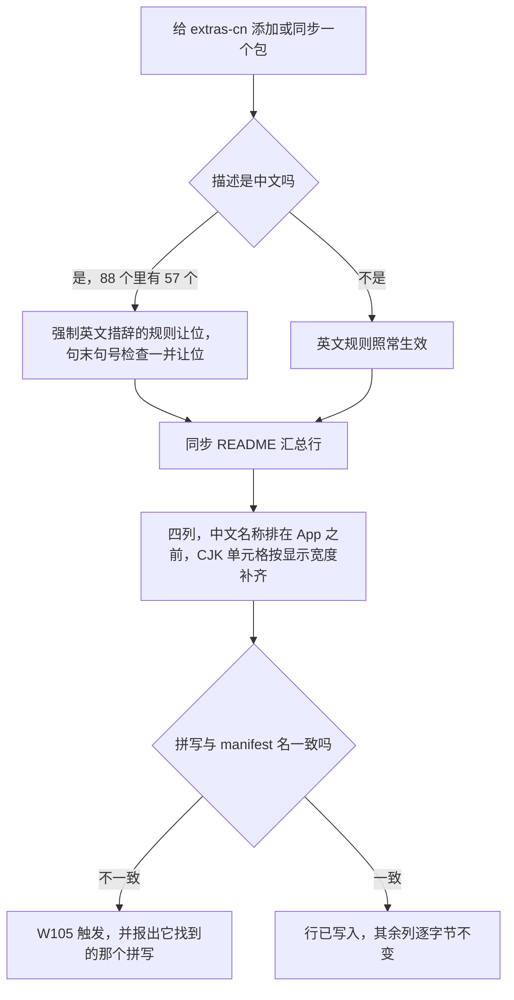

## 维护一个 skill

每个 skill 都能离线自检：

```bash
python scripts/selfcheck.py                # 多数包：身份、文档指针、样例往返
python scripts/sm_selftest.py              # Scoop 系：完整自检
python scripts/check_style.py --selfcheck  # project-tex：脚本与规则表双向核对
python scripts/corner_audit.py             # anchor-*：身份、schema、文档 ↔ 配置、纯度
python scripts/corner_bank.py check        # anchor-*：题库是真源，md 只是呈现
python scripts/verify.py .                 # skill-draft：逐文件门禁 + 包内自检
```

这些自检不是装饰。它们双向强制配方 ↔ 构建器覆盖、文档 ↔ 代码一致（`project-tex` 的规则表必须与代码逐字相符，`project-py` / `project-typ` 的清单与规则对账）、针对真实 bucket 的往返序列化、README 同步幂等，以及每个包里「`SKILL.md` 的 `name` 等于目录名、它引用的文件真实存在」这条规则。

门禁指向整包或整个仓库时，`package-selfcheck` 会把上列自检一起跑掉；单文件门禁不触发它。`docs/*.md` 的表格列宽是唯一硬口径，包内 `references/` 只做诊断、不重排——Scoop 三包的自检要求 README 汇总表逐字节往返，盲目统一列宽会把它改坏。

想只读核对：`python skill-draft/scripts/verify.py --list` 列门禁规则表，`python tools/parity_check.py` 核对外发 fork（Scoop 与 anchor 姊妹包）的同源脚本有没有漂移。完整门禁的修复阶段会写盘，别把它当只读检查。

### 动手编辑前值得知道的三条约定

**绝不要给 Scoop 系 skill 添加 `.json` 数据文件。** bucket CI 会把仓库里每个*变更过的* `.json` 都拿去按 Scoop 的 manifest schema 校验——而且是全仓库范围的，因为变更文件列表忽略了它的路径过滤。skill 里一个非 manifest 的 `.json` 就会让 CI 变红。这就是配方目录以 `assets/recipes.jsonc` 交付的原因：`.jsonc` 后缀是刻意的规避，而其内容保持严格 JSON，不使用注释。

**绝不要把机器本地绝对路径写进 skill。** 包会被复制和移植，硬编码路径在复制的那一刻就变错。引用 skill 自身用 `<this skill dir>` 占位符，引用家目录用 `~`，工具与环境位置一律运行时解析。`skill-draft` 的 `no-local-paths` 检查为此兜底。

**不要把多个异常交给 `ruff format` 去改写。** 在 Python 3.14 下，它会把 `except (A, B):` 变成 PEP 758 的裸形式 `except A, B:`，那只有 3.14+ 能解析；`except (A, B) as e:` 也不是退路，它会触发 F841，autofix 删掉 `as` 后格式化又改回裸形式。统一拆成独立 `except` 子句，并用 `ast.parse(src, feature_version=(3, 13))` 复核全仓可解析性。门禁的修复阶段会写盘，所以这不是理论风险。
